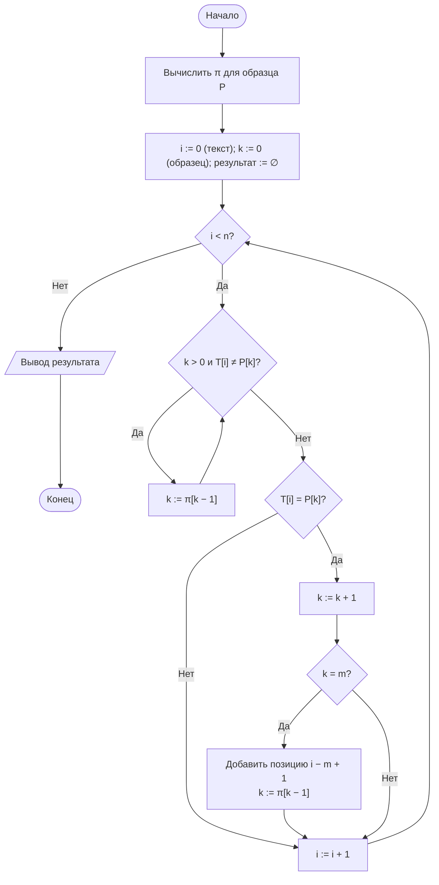
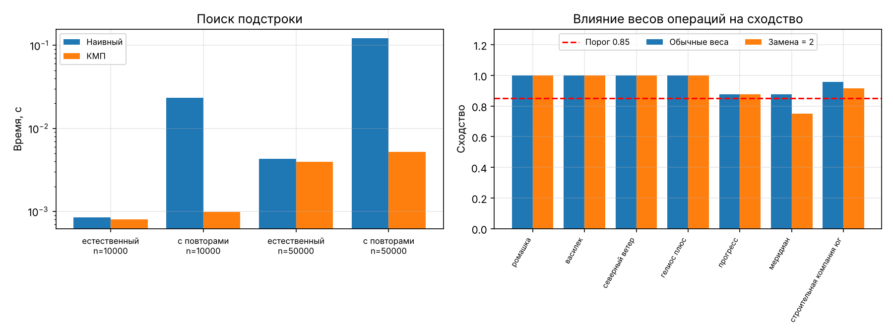

# Отчёт по лабораторной работе № 11

## Алгоритмы поиска подстроки и вычисления редакционного расстояния

---

## 1. Титульный лист

| | |
|---|---|
| **Дисциплина** | Теория алгоритмов |
| **Направление подготовки** | 38.03.05 «Бизнес-информатика» |
| **Курс** | 2 |
| **Лабораторная работа** | № 11. Алгоритмы поиска подстроки и вычисления редакционного расстояния |
| **Вариант** | 19 |
| **Выполнила** | Ситникова Ольга Алексеевна, группа БИ2-1 |
| **Проверил** | ______________________ |
| **Год** | 2026 |

---

## 2. Цель работы и задание варианта

**Цель работы:** изучить алгоритмы обработки текстовых данных — точный поиск подстроки и оценку близости строк — и применить их к задаче сопоставления записей из разных информационных систем.

**Задание варианта 19:**

| Параметр | Значение |
|---|---|
| Образец для ручного расчёта префикс-функции π | abcbabc |
| Тип текста | естественный текст |
| Длины текста n | 10⁴; 5 · 10⁴ |
| Порог сходства | 0,85 |
| Дополнительное задание | Л5 — ввести различные веса операций (замена стоит 2, вставка и удаление — по 1) и исследовать влияние на результат сопоставления |

**Что выполнено:**

1. Реализованы наивный поиск подстроки и алгоритм Кнута — Морриса — Пратта (КМП) с префикс-функцией; в обоих подсчитывается число сравнений символов.
2. Префикс-функция для образца abcbabc вычислена вручную и сверена с программой.
3. Измерено время обоих алгоритмов на тексте естественного типа при n = 10⁴ и 5 · 10⁴; для сравнения добавлен «неудобный» текст с повторами.
4. Реализованы расстояние Левенштейна (в том числе взвешенное) и нормированная мера сходства.
5. Решена задача сопоставления наименований контрагентов (нормализация, точное и нечёткое сопоставление с порогом 0,85).
6. Выполнено дополнительное задание Л5: сопоставление выполнено при обычных весах и при весе замены 2, влияние весов оценено.

---

## 3. Описание алгоритмов и оценки сложности

### 3.1. Задача поиска подстроки

Даны текст T длиной n и образец P длиной m (m ≤ n). Требуется найти все позиции i, для которых T[i..i+m−1] = P.

### 3.2. Наивный алгоритм

Образец последовательно прикладывается ко всем позициям текста, и в каждой выполняется посимвольное сравнение до первого несовпадения. В худшем случае Θ((n − m + 1) · m) = Θ(nm); худший случай достигается на текстах с повторами (например, T = aa…a и P = aa…ab). На естественном тексте несовпадение обычно обнаруживается на первом символе, поэтому среднее число сравнений близко к Θ(n).

### 3.3. Алгоритм Кнута — Морриса — Пратта

При несовпадении указатель в тексте не возвращается назад: образец сдвигается на величину, вычисленную заранее по самому образцу.

**Префикс-функция.** Для строки P значение π[i] — длина наибольшего собственного префикса подстроки P[0..i], который одновременно является её суффиксом. Если после k совпавших символов следующий не совпал, то сравнение продолжается с символа P[π[k − 1]]: первые π[k − 1] символов образца уже совпали с концом просмотренной части текста.

**Трудоёмкость:** предобработка Θ(m), поиск Θ(n), всего Θ(n + m) в худшем случае (величина k за весь проход увеличивается не более n раз и поэтому уменьшается тоже не более n раз).

| Алгоритм | Предобработка | Поиск | Худший случай |
|---|---|---|---|
| Наивный | нет | — | Θ(nm) |
| Кнута — Морриса — Пратта | Θ(m) | Θ(n) | Θ(n + m) |

**Блок-схема алгоритма КМП:**



### 3.4. Расстояние Левенштейна

Расстояние d(A, B) — минимальное число элементарных операций (вставка, удаление, замена символа), преобразующих строку A в строку B. Пусть D[i][j] — расстояние между префиксами A[0..i−1] и B[0..j−1]:

D[i][j] = min( D[i−1][j] + 1 (удаление), D[i][j−1] + 1 (вставка), D[i−1][j−1] + c (замена) ),

где c = 0, если A[i−1] = B[j−1], и c = 1 иначе. Граничные условия: D[i][0] = i, D[0][j] = j. Трудоёмкость Θ(nm) по времени; при хранении только двух строк таблицы память равна Θ(min(n, m)), но тогда нельзя восстановить последовательность операций.

**Нормированная мера сходства:** sim(A, B) = 1 − d(A, B) / max(|A|, |B|), значение лежит в диапазоне от 0 до 1.

### 3.5. Взвешенное расстояние (Л5)

Операциям назначаются стоимости: w_ins — вставка, w_del — удаление, w_rep — замена. В рекуррентной формуле слагаемые «+ 1» заменяются соответствующими стоимостями, а «+ c» — на w_rep при несовпадении символов. В работе сравниваются два режима: **обычные веса** (1, 1, 1) и **замена = 2, вставка = 1, удаление = 1**. При w_rep = 2 замена символа равна по стоимости удалению плюс вставке (1 + 1), поэтому расстояние становится «индельным»: опечатка-замена обходится вдвое дороже, а вставка и удаление — по-прежнему в 1. Мера сходства вычисляется по той же формуле (при нормировке на max(|A|, |B|) и отсечении значений ниже 0).

### 3.6. Нечёткое сопоставление записей

Порядок обработки наименований контрагентов двух систем:

1. **Нормализация:** нижний регистр, замена «ё» на «е», удаление кавычек, дефисов и знаков препинания, удаление организационно-правовых форм (ООО, ОАО, ЗАО, ПАО, АО, ИП), сжатие пробелов.
2. **Точное сопоставление** нормализованных строк.
3. **Нечёткое сопоставление** оставшихся записей по мере сходства с порогом 0,85: для записи системы А выбирается запись системы Б с наибольшим сходством, и пара принимается, если сходство не меньше порога.

Сопоставление «каждый с каждым» имеет трудоёмкость Θ(N² · L²) (N — число записей, L — длина), поэтому на больших объёмах требуется предварительная фильтрация кандидатов.

---

## 4. Ручной расчёт префикс-функции для образца «abcbabc»

Образец P = abcbabc, m = 7. Значение π[i] — длина наибольшего собственного префикса подстроки P[0..i], равного её суффиксу; π[0] = 0 по определению.

| Шаг i | Символ | Префикс P[0..i] | Наибольший собственный префикс, равный суффиксу | π[i] |
|---|---|---|---|---|
| 0 | a | a | нет (собственных префиксов нет) | 0 |
| 1 | b | ab | префикс «a», суффикс «b» — не равны | 0 |
| 2 | c | abc | префиксы «a», «ab» и суффиксы «c», «bc» — не равны | 0 |
| 3 | b | abcb | префиксы «a», «ab», «abc» и суффиксы «b», «cb», «bcb» — не равны | 0 |
| 4 | a | abcba | «a» (префикс «a» = суффикс «a») | 1 |
| 5 | b | abcbab | «ab» (префикс «ab» = суффикс «ab») | 2 |
| 6 | c | abcbabc | «abc» (префикс «abc» = суффикс «abc») | 3 |

**Ручной результат: π = [0, 0, 0, 0, 1, 2, 3].**

**Пояснение через алгоритм построения** (k — длина текущего совпадения префикса с суффиксом): при i = 1, 2, 3 символы P[i] не равны P[0] = «a», и k остаётся 0; при i = 4 символ «a» совпал с P[0], поэтому k = 1; при i = 5 символ «b» совпал с P[1], k = 2; при i = 6 символ «c» совпал с P[2], k = 3.

**Смысл в поиске.** Если при сравнении образца с текстом совпали первые 6 символов «abcbab» (k = 6) и седьмой не совпал, то π[5] = 2 означает, что последние два совпавших символа «ab» уже являются началом образца: сравнение продолжается с P[2] = «c» без возврата по тексту. После полного совпадения (k = 7) используется π[6] = 3: следующее вхождение может частично перекрываться с найденным на 3 символа («abc»).

Программа даёт тот же результат: `[0, 0, 0, 0, 1, 2, 3]` (сверка выполняется оператором `assert` в коде).

---

## 5. Фрагмент таблицы редакционного расстояния

Пара слов: «кошка» → «окошко». Таблица D[i][j] (строки — префиксы слова «кошка», столбцы — префиксы слова «окошко»), вывод программы:

| | ∅ | о | к | о | ш | к | о |
|---|---|---|---|---|---|---|---|
| **∅** | 0 | 1 | 2 | 3 | 4 | 5 | 6 |
| **к** | 1 | 1 | 1 | 2 | 3 | 4 | 5 |
| **о** | 2 | 1 | 2 | 1 | 2 | 3 | 4 |
| **ш** | 3 | 2 | 2 | 2 | 1 | 2 | 3 |
| **к** | 4 | 3 | 2 | 3 | 2 | 1 | 2 |
| **а** | 5 | 4 | 3 | 3 | 3 | 2 | **2** |

Расстояние d(«кошка», «окошко») = D[5][6] = **2**.

**Пример вычисления ячейки:** D[1][1] (префиксы «к» и «о», символы различны) = min(D[0][1] + 1, D[1][0] + 1, D[0][0] + 1) = min(2, 2, 1) = 1; D[1][2] («к» и «ок», символы совпадают) = min(D[0][2] + 1, D[1][1] + 1, D[0][1] + 0) = min(3, 2, 1) = 1.

**Последовательность операций (путь по таблице):** вставить «о» в начало («кошка» → «окошка», D = 1), затем заменить последнюю «а» на «о» («окошка» → «окошко», D = 2). При весе замены 2 расстояние становится равным 3 (например, вставка «о» в начало, удаление «а» и вставка «о» в конец), что подтверждается программой: «d = 2, с весом замены 2: d = 3».

---

## 6. Листинг программы

Файл `lab11_variant19.py` (Python 3.10+, для графиков нужна библиотека `matplotlib`). Каждая строка снабжена комментарием.

```python
"""Лабораторная работа № 11. Вариант 19. Ситникова Ольга Алексеевна."""
import platform  # сведения о компьютере
import random  # генерация текста
import re  # удаление знаков препинания при нормализации
import time  # замер времени
import matplotlib.pyplot as plt  # графики

PI_PATTERN, SIZES, THRESHOLD = "abcbabc", [10**4, 5 * 10**4], 0.85  # образец для ручного расчёта π, длины текста и порог сходства (вариант 19)
WORDS = ("и в на что с по для не как из к от это при за о а но или все данных система информация алгоритм процесс анализ задача результат "
         "метод проект работа время код программа модель структура значение связь сеть запись поиск текст строка память таблица граф ключ "
         "ответ расчёт срок обработка управление решение качество требование ресурс компания клиент рынок договор платёж отчёт документ "
         "учёт склад заказ поставка сотрудник команда план цель риск оценка контроль доступ сервер сообщение файл версия ошибка проверка "
         "тест функция список очередь стек дерево путь вершина ребро вес цикл порядок сумма разность").split()  # словарь: частые слова идут первыми
WEIGHTS = [1 / (i + 5) for i in range(len(WORDS))]  # закон Ципфа со сдвигом ранга: вес слова убывает с рангом
LEGAL_FORMS = {"ооо", "оао", "зао", "пао", "ао", "ип"}  # организационно-правовые формы для удаления


def natural_text(n, seed=7):  # модель естественного текста: предложения из слов с частотами по закону Ципфа
    rng, parts, length = random.Random(seed), [], 0  # генератор, части текста и текущая длина
    while length < n:  # пока текст короче n
        sentence = " ".join(rng.choices(WORDS, WEIGHTS, k=rng.randint(6, 14))).capitalize() + ". "  # предложение из 6…14 слов
        parts.append(sentence)  # добавляем предложение
        length += len(sentence)  # увеличиваем длину
    return "".join(parts)[:n]  # обрезаем текст до n символов


def naive_search(text, pattern):  # наивный поиск: позиции и число сравнений символов
    n, m, positions, comparisons = len(text), len(pattern), [], 0  # длины, найденные позиции и счётчик
    for i in range(n - m + 1):  # образец прикладывается к каждой позиции
        j = 0  # число совпавших символов
        while j < m:  # посимвольное сравнение
            comparisons += 1  # считаем сравнение
            if text[i + j] != pattern[j]:  # несовпадение
                break  # переходим к следующей позиции
            j += 1  # символ совпал
        if j == m:  # совпал весь образец
            positions.append(i)  # запоминаем позицию
    return positions, comparisons  # результат


def prefix_function(pattern):  # префикс-функция: pi[i] — длина наибольшего собственного префикса P[0..i], равного его суффиксу
    pi, k = [0] * len(pattern), 0  # значения и длина текущего совпадения
    for i in range(1, len(pattern)):  # перебираем символы образца
        while k > 0 and pattern[i] != pattern[k]:  # несовпадение
            k = pi[k - 1]  # откатываемся к более короткому префиксу
        if pattern[i] == pattern[k]:  # символы совпали
            k += 1  # увеличиваем длину совпадения
        pi[i] = k  # записываем значение
    return pi  # префикс-функция


def kmp_search(text, pattern):  # алгоритм Кнута — Морриса — Пратта, Θ(n + m)
    pi, positions, comparisons, k = prefix_function(pattern), [], 0, 0  # префикс-функция, позиции, счётчик и длина совпадения
    for i, ch in enumerate(text):  # указатель по тексту не возвращается назад
        while k > 0 and ch != pattern[k]:  # несовпадение после k совпавших символов
            comparisons += 1  # считаем сравнение
            k = pi[k - 1]  # сдвигаем образец по префикс-функции
        comparisons += 1  # сравнение символа текста с pattern[k]
        if ch == pattern[k]:  # символы совпали
            k += 1  # продолжаем совпадение
        if k == len(pattern):  # найдено вхождение
            positions.append(i - len(pattern) + 1)  # запоминаем позицию начала
            k = pi[k - 1]  # готовимся к следующему вхождению
    return positions, comparisons  # результат


def edit_table(a, b, w_ins=1, w_del=1, w_rep=1):  # полная таблица редакционного расстояния a -> b с весами операций
    D = [[0] * (len(b) + 1) for _ in range(len(a) + 1)]  # таблица (len(a)+1) × (len(b)+1)
    for i in range(1, len(a) + 1):  # первый столбец: удаление i символов
        D[i][0] = i * w_del  # стоимость удаления
    for j in range(1, len(b) + 1):  # первая строка: вставка j символов
        D[0][j] = j * w_ins  # стоимость вставки
    for i in range(1, len(a) + 1):  # заполняем таблицу по строкам
        for j in range(1, len(b) + 1):  # по столбцам
            D[i][j] = min(D[i - 1][j] + w_del, D[i][j - 1] + w_ins, D[i - 1][j - 1] + (0 if a[i - 1] == b[j - 1] else w_rep))  # удаление, вставка, замена
    return D  # таблица


def levenshtein(a, b, w_ins=1, w_del=1, w_rep=1):  # расстояние Левенштейна, Θ(nm) времени и Θ(len(b)) памяти
    prev = [j * w_ins for j in range(len(b) + 1)]  # предыдущая строка таблицы
    for i, ca in enumerate(a, start=1):  # по символам a
        cur = [i * w_del]  # текущая строка начинается с удаления i символов
        for j, cb in enumerate(b, start=1):  # по символам b
            cur.append(min(prev[j] + w_del, cur[j - 1] + w_ins, prev[j - 1] + (0 if ca == cb else w_rep)))  # удаление, вставка, замена
        prev = cur  # переходим к следующей строке
    return prev[-1]  # расстояние


def similarity(a, b, **w):  # нормированная мера сходства из [0; 1]
    if not a and not b:  # обе строки пусты
        return 1.0  # полное сходство
    return max(0.0, 1 - levenshtein(a, b, **w) / max(len(a), len(b)))  # 1 - d / max(длин), не меньше 0


def normalize(name):  # нормализация наименования контрагента
    s = re.sub(r"[\"'«»„“”.,()\-]", " ", name.lower().replace("ё", "е"))  # нижний регистр, «ё» -> «е», удаление знаков
    return " ".join(w for w in s.split() if w not in LEGAL_FORMS)  # удаление организационно-правовых форм и лишних пробелов


def match_records(list_a, list_b, threshold, **w):  # сопоставление двух списков наименований
    norm_b, result = [(b, normalize(b)) for b in list_b], []  # нормализованный список B и результат
    for a in list_a:  # для каждой записи системы А
        na, best, best_sim, kind = normalize(a), None, 0.0, ""  # нормализованное имя и лучший кандидат
        for b, nb in norm_b:  # перебираем записи системы Б
            if na == nb:  # точное совпадение после нормализации
                best, best_sim, kind = b, 1.0, "точное"  # фиксируем и выходим
                break  # лучшего не бывает
            s = similarity(na, nb, **w)  # нечёткое сходство
            if s > best_sim:  # кандидат лучше текущего
                best, best_sim, kind = b, s, "нечёткое"  # запоминаем
        result.append((a, best, best_sim, kind if best_sim >= threshold else "не найдено"))  # решение по порогу
    return result  # список (запись А, кандидат Б, сходство, тип)


def best_time(func, repeats):  # лучшее время func из нескольких повторов, с
    times = []  # времена повторов
    for _ in range(repeats):  # повторы
        t0 = time.perf_counter()  # начало замера
        func()  # запуск
        times.append(time.perf_counter() - t0)  # длительность
    return min(times)  # наименее искажённое помехами значение


SYSTEM_A = ['ООО «Ромашка»', "АО Василёк", 'ООО «Северный ветер»', 'ПАО «Технопром»', 'ООО «Гелиос-Плюс»', 'АО «Прогресс»', 'ООО «Меридиан»',
            "ИП Петров П.П.", 'ООО «Альфа»', 'ЗАО «Восход»', 'ООО «Строительная компания Юг»', 'ПАО «Гранит»']  # записи системы А
SYSTEM_B = ["Ромашка, ООО", "ВАСИЛЕК АО", "Северный Ветер ООО", "Технопорм ПАО", "Гелиос Плюс ООО", "ПАО Прогрес", "Мередиан ООО",
            "Петров Пётр Петрович", "Альфа-Бета ООО", "Восхот ЗАО", "Строительная компания Юк ООО", "Гранит-Строй ПАО"]  # записи системы Б

if __name__ == "__main__":  # запуск только при прямом старте файла
    print(platform.platform(), "|", platform.processor() or platform.machine(), "| Python", platform.python_version())  # система
    print(f"\nПрефикс-функция для '{PI_PATTERN}':", prefix_function(PI_PATTERN))  # результат для сверки с ручным расчётом
    assert prefix_function(PI_PATTERN) == [0, 0, 0, 0, 1, 2, 3]  # совпадает с ручным расчётом из отчёта
    a, b = "кошка", "окошко"  # пара коротких слов для таблицы
    print(f"\nТаблица редакционного расстояния '{a}' -> '{b}':")  # заголовок таблицы
    print("      ∅  " + "  ".join(b))  # заголовок столбцов
    for i, row in enumerate(edit_table(a, b)):  # строки таблицы
        print(f"  {'∅' if i == 0 else a[i - 1]}  " + "  ".join(f"{x}" for x in row))  # строка с подписью
    print(f"  d = {levenshtein(a, b)}, с весом замены 2: d = {levenshtein(a, b, w_rep=2)}")  # расстояния
    pattern, repeats = "алгоритм", ("a" * 50 + "b")  # образцы для естественного текста и текста с повторами
    print("\n      n |        текст | наивный, с |  КМП, с | сравнений (наив.) | сравнений (КМП) | вхождений")  # заголовок таблицы
    rows = []  # результаты для графика
    for n in SIZES:  # длины текста
        for label, text, p in (("естественный", natural_text(n), pattern), ("с повторами", "a" * n, repeats)):  # два типа текста
            (pos1, c1), (pos2, c2) = naive_search(text, p), kmp_search(text, p)  # оба алгоритма
            assert pos1 == pos2 and len(pos1) == text.count(p)  # результаты совпадают и согласуются с str.count
            t1, t2 = best_time(lambda: naive_search(text, p), 3), best_time(lambda: kmp_search(text, p), 3)  # времена
            rows.append((n, label, t1, t2, c1, c2))  # сохраняем строку
            print(f"{n:>7} | {label:>12} | {t1:>10.4f} | {t2:>7.4f} | {c1:>17} | {c2:>15} | {len(pos1):>9}")  # строка таблицы
    print(f"\nПример текста (первые 150 символов): {natural_text(150)}")  # фрагмент модели текста
    weights = {"обычные веса (1, 1, 1)": {}, "замена = 2, вставка и удаление = 1": {"w_rep": 2}}  # наборы весов для Л5
    results = {name: match_records(SYSTEM_A, SYSTEM_B, THRESHOLD, **w) for name, w in weights.items()}  # сопоставление при разных весах
    print(f"\nСопоставление записей (порог {THRESHOLD}):")  # заголовок
    print(f"{'Система А':<32}{'Система Б (обычные веса)':<32}{'сходство':>9} {'тип':<11}| {'сходство':>9} {'тип':<11}| при весе замены 2")  # заголовок таблицы
    for (a, b1, s1, k1), (_, b2, s2, k2) in zip(*results.values()):  # сопоставляем результаты двух режимов
        print(f"{a:<32}{(b1 or '—') if k1 != 'не найдено' else '—':<32}{s1:>9.3f} {k1:<11}| {s2:>9.3f} {k2:<11}| {(b2 or '—') if k2 != 'не найдено' else '—'}")  # строка
    for name, res in results.items():  # итоги по режимам
        print(f"  {name}: сопоставлено {sum(r[3] != 'не найдено' for r in res)} из {len(res)}, точных {sum(r[3] == 'точное' for r in res)}")  # итог
    fig, (ax1, ax2) = plt.subplots(1, 2, figsize=(12, 4.5))  # два графика рядом
    labels = [f"{r[1]}\nn={r[0]}" for r in rows]  # подписи столбцов
    xs = range(len(rows))  # положения столбцов
    ax1.bar([x - 0.2 for x in xs], [r[2] for r in rows], 0.4, label="Наивный")  # время наивного алгоритма
    ax1.bar([x + 0.2 for x in xs], [r[3] for r in rows], 0.4, label="КМП")  # время КМП
    ax1.set_xticks(list(xs), labels, fontsize=8)  # подписи по оси x
    ax1.set(ylabel="Время, с", title="Поиск подстроки", yscale="log")  # оформление
    names = [normalize(a) for a, _, _, k in results["обычные веса (1, 1, 1)"] if k != "не найдено"]  # записи, найденные при обычных весах
    sims = {n: [s for a, _, s, k in res if normalize(a) in names] for n, res in results.items()}  # сходства найденных пар
    ax2.bar([x - 0.2 for x in range(len(names))], sims["обычные веса (1, 1, 1)"], 0.4, label="Обычные веса")  # сходство при обычных весах
    ax2.bar([x + 0.2 for x in range(len(names))], sims["замена = 2, вставка и удаление = 1"], 0.4, label="Замена = 2")  # сходство при весе замены 2
    ax2.axhline(THRESHOLD, color="red", linestyle="--", label=f"Порог {THRESHOLD}")  # линия порога
    ax2.set_xticks(range(len(names)), names, rotation=60, ha="right", fontsize=7)  # подписи записей
    ax2.set(ylabel="Сходство", title="Влияние весов операций на сходство")  # оформление
    ax2.set_ylim(0, 1.3)  # запас сверху для легенды
    for ax in (ax1, ax2):  # общее оформление
        ax.grid(True, alpha=0.3)  # сетка
        ax.legend(ncol=3 if ax is ax2 else 1, loc="upper center" if ax is ax2 else "upper left", fontsize=8)  # легенда
    plt.tight_layout()  # убираем наложение подписей
    plt.savefig("lab11_graphs.png", dpi=150)  # сохраняем график для отчёта
    plt.show()  # показываем график на экране
```

---

## 7. Таблицы измерений и графики

**Условия измерений:** Linux (Ubuntu 24.04), Intel Xeon @ 2,10 ГГц (1 виртуальное ядро), 3 ГБ ОЗУ, Python 3.12.3, matplotlib 3.11. Время — лучшее из трёх повторов (`time.perf_counter()`). Правильность поиска проверена: позиции наивного алгоритма и КМП совпадают, а число вхождений равно результату `str.count`.

**Тексты.**

- **Естественный текст** — модель текста на русском языке: предложения из 6–14 слов, которые выбираются из словаря в 95 слов (например, «данных», «система», «алгоритм», «проверка») с вероятностями, убывающими с рангом слова по закону Ципфа (вес слова 1 / (n + 5), где n — номер слова в словаре, начиная с нуля); первое слово предложения пишется с заглавной буквы, в конце — точка. Такая модель сохраняет свойства, существенные для поиска: реальные слова и буквы, разные частоты букв, преобладание коротких несовпадений. Образец поиска — слово «алгоритм» (по этому образцу найдено 19 вхождений при n = 10⁴ и 102 при n = 5 · 10⁴).
- **Текст с повторами** («неудобный», для сравнения) — n символов «a» и образец из 50 символов «a» и завершающего «b» (длина m = 51).

**Таблица 1. Сравнение алгоритмов поиска подстроки**

| n | Текст | Наивный, с | КМП, с | Сравнений (наивный) | Сравнений (КМП) | Вхождений |
|---|---|---|---|---|---|---|
| 10⁴ | естественный | 0,0008 | 0,0008 | 10 969 | 10 814 | 19 |
| 10⁴ | с повторами | 0,0233 | 0,0010 | 507 450 | 19 950 | 0 |
| 5 · 10⁴ | естественный | 0,0043 | 0,0039 | 54 727 | 53 931 | 102 |
| 5 · 10⁴ | с повторами | 0,1211 | 0,0052 | 2 547 450 | 99 950 | 0 |

**Анализ.**

- На **естественном тексте** оба алгоритма делают около 1,1 · n сравнений (10 969 / 10⁴ = 1,10 и 54 727 / 5 · 10⁴ = 1,09 у наивного; 1,08 у КМП) и работают одинаково быстро: несовпадение обнаруживается почти всегда на первом символе образца, поэтому ни возвращаться по тексту, ни сдвигать образец по префикс-функции практически не приходится.
- На **тексте с повторами** наивный алгоритм делает (n − m + 1) · m сравнений (например, 9950 · 51 = 507 450 при n = 10⁴) — это точно соответствует оценке Θ(nm), тогда как КМП выполняет около 2n сравнений (19 950 и 99 950). Выигрыш по числу сравнений — в 25 раз, по времени — в 23–25 раз (0,0233 против 0,0010 с и 0,1211 против 0,0052 с).
- Время обоих алгоритмов на естественном тексте при росте n в 5 раз растёт примерно в 5 раз (0,0008 → 0,0043 и 0,0008 → 0,0039), что соответствует Θ(n).

**Графики** (слева — время поиска, ось ординат логарифмическая; справа — сходство найденных пар при двух наборах весов, см. раздел 8):



---

## 8. Результат сопоставления записей

Сопоставлены 12 записей системы А с 12 записями системы Б (порог сходства 0,85, обычные веса операций). Данные — учебные, вымышленные наименования, в которые заложены типичные расхождения: порядок слов, регистр, кавычки, дефисы, опечатки разных видов.

**Таблица 2. Найденные пары и оценка сходства (обычные веса)**

| Система А | Система Б | Сходство | Тип сопоставления |
|---|---|---|---|
| ООО «Ромашка» | Ромашка, ООО | 1,000 | точное (после нормализации) |
| АО Василёк | ВАСИЛЕК АО | 1,000 | точное (после нормализации) |
| ООО «Северный ветер» | Северный Ветер ООО | 1,000 | точное (после нормализации) |
| ООО «Гелиос-Плюс» | Гелиос Плюс ООО | 1,000 | точное (после нормализации) |
| ООО «Строительная компания Юг» | Строительная компания Юк ООО | 0,958 | нечёткое |
| АО «Прогресс» | ПАО Прогрес | 0,875 | нечёткое |
| ООО «Меридиан» | Мередиан ООО | 0,875 | нечёткое |
| ПАО «Технопром» | — (лучший кандидат «Технопорм ПАО») | 0,778 | не найдено |
| ЗАО «Восход» | — (лучший кандидат «Восхот ЗАО») | 0,833 | не найдено |
| ИП Петров П.П. | — | 0,500 | не найдено |
| ООО «Альфа» | — (лучший кандидат «Альфа-Бета ООО») | 0,500 | не найдено |
| ПАО «Гранит» | — (лучший кандидат «Гранит-Строй ПАО») | 0,500 | не найдено |

Итог: сопоставлено 7 записей из 12 (4 точных и 3 нечётких).

- **Точные совпадения (4)** получены только за счёт нормализации: различия в регистре, порядке слов, организационно-правовых формах, кавычках, запятых и дефисах убраны, и нечёткое сравнение не потребовалось.
- **Нечёткие совпадения (3):** опечатки — потеря буквы «с» в «Прогресс», замена «и» на «е» в «Меридиан», замена «г» на «к» в длинном наименовании «Строительная компания Юг».
- **Отказы (5).** «Альфа» и «Гранит» — разные организации с похожими названиями («Альфа-Бета», «Гранит-Строй»), отказ правильный; «ИП Петров П.П.» и «Петров Пётр Петрович» — разная форма записи имени, нужно отдельное правило для ФИО. Для «Технопром» (перестановка двух букв, d = 2) и «Восход» (одна замена в слове из 6 букв, сходство 0,833) вероятно, речь об одной организации, но сходство ниже порога 0,85: это **ложные отказы**, вызванные малой длиной названия — одна ошибка в слове из 6 букв снижает сходство на 1/6.

### 8.1. Влияние весов операций (Л5)

Сопоставление повторено при весе замены 2 (вставка и удаление по 1).

**Таблица 3. Сходство при обычных весах и при весе замены 2 (нормализованные названия)**

| Пара (после нормализации) | Тип расхождения | d, обычные веса | Сходство | d, замена = 2 | Сходство | Решение при пороге 0,85 |
|---|---|---|---|---|---|---|
| меридиан — мередиан | замена буквы | 1 | 0,875 | 2 | 0,750 | **принято → отклонено** |
| строительная компания юг — … юк | замена буквы | 1 | 0,958 | 2 | 0,917 | принято в обоих режимах |
| восход — восхот | замена буквы | 1 | 0,833 | 2 | 0,667 | отклонено в обоих режимах |
| прогресс — прогрес | удаление буквы | 1 | 0,875 | 1 | 0,875 | принято в обоих режимах |
| технопром — технопорм | перестановка двух букв | 2 | 0,778 | 2 | 0,778 | отклонено в обоих режимах |

**Результат:** при обычных весах сопоставлено 7 записей из 12, при весе замены 2 — 6 из 12 (точных по-прежнему 4). Пара «Меридиан» — «Мередиан» перестала сопоставляться: сходство снизилось с 0,875 до 0,750, то есть ниже порога 0,85.

**Выводы по влиянию весов.**

- При весе замены 2 каждая замена символа обходится вдвое дороже, поэтому **опечатки-замены** становятся «дороже» (сходство падает), а **вставки и удаления** (потеря или лишняя буква) не меняют результата. Перестановка двух соседних букв стоит 2 в обоих режимах (её можно выполнить как удаление и вставку), поэтому сходство такой пары не меняется.
- Влияние зависит от длины строки: у короткого названия «Меридиан» (8 символов) сходство упало ниже порога, у длинного «Строительная компания Юг» (24 символа) — с 0,958 до 0,917, но решение осталось тем же.
- Усиленный штраф за замену делает сопоставление строже: пропускаются записи с опечатками-заменами, зато уменьшается риск ложных совпадений между разными организациями с близкими названиями. Выбор весов нужно согласовывать с типом ошибок в данных (замены — типичная ошибка набора, вставки и удаления — пропуск или лишняя буква) и с порогом сходства; при весе замены 2 порог целесообразно снижать (например, до 0,75–0,80), чтобы не потерять пары с одной опечаткой.

---

## 9. Выводы

1. На естественном тексте наивный алгоритм и КМП сопоставимы: оба выполняют около 1,1 · n сравнений и работают одинаково быстро (0,0008 с и 0,0043 с при n = 10⁴ и 5 · 10⁴), так как несовпадение почти всегда обнаруживается на первом символе образца.
2. На тексте с повторами различие принципиально: у наивного алгоритма число сравнений равно (n − m + 1) · m (2,5 млн при n = 5 · 10⁴), у КМП — около 2n (99 950); по времени КМП быстрее в 23–25 раз. Худший случай наивного алгоритма реализуется на данных, встречающихся на практике (журналы с однотипными записями, длинные последовательности одинаковых символов), поэтому КМП предпочтителен, когда нужна гарантия линейного времени.
3. Префикс-функция образца abcbabc, вычисленная вручную, [0, 0, 0, 0, 1, 2, 3], совпала с результатом программы; значение π[6] = 3 показывает, что следующее вхождение может перекрываться с предыдущим на три символа.
4. Расстояние Левенштейна корректно улавливает опечатки и различия в окончаниях; таблица для пары «кошка» → «окошко» даёт d = 2. Нормализация наименований (регистр, кавычки, дефисы, организационно-правовые формы) перевела 4 пары из 12 в разряд точных совпадений; нечёткое сопоставление добавило ещё 3 пары, итого 7 из 12 при пороге 0,85.
5. Порог сходства 0,85 вызывает ложные отказы на коротких названиях (сходство «Восход» — «Восхот» равно 0,833), а на разных организациях с общим словом (например, «Гранит» и «Гранит-Строй») правильно отказывает. Короткие названия и ФИО требуют отдельных правил или более низкого порога.
6. По дополнительному заданию Л5: вес замены 2 удваивает стоимость замен, не меняет стоимость вставок, удалений и перестановок соседних букв и делает сопоставление строже — число найденных пар снизилось с 7 до 6 (потеряна пара «Меридиан» — «Мередиан», сходство 0,875 → 0,750). Веса операций и порог необходимо подбирать вместе, исходя из того, какие ошибки в данных наиболее вероятны.
7. Сравнение «каждый с каждым» имеет трудоёмкость Θ(N² · L²) и на больших объёмах требует предварительного блокирования кандидатов (по первой букве, по длине), а точное сопоставление нормализованных строк (хеш-таблица) следует выполнять первым, чтобы нечёткое сравнение применять только к остатку.
